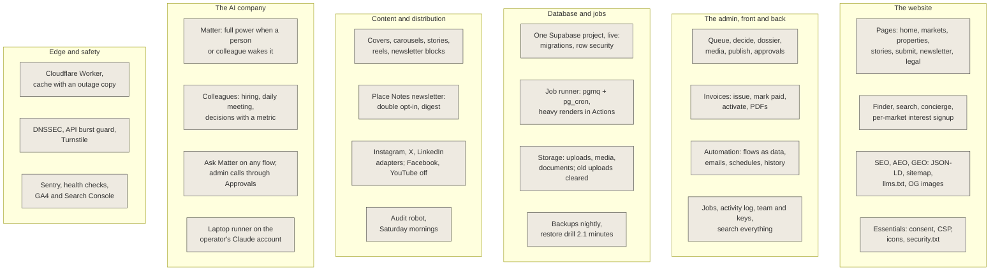
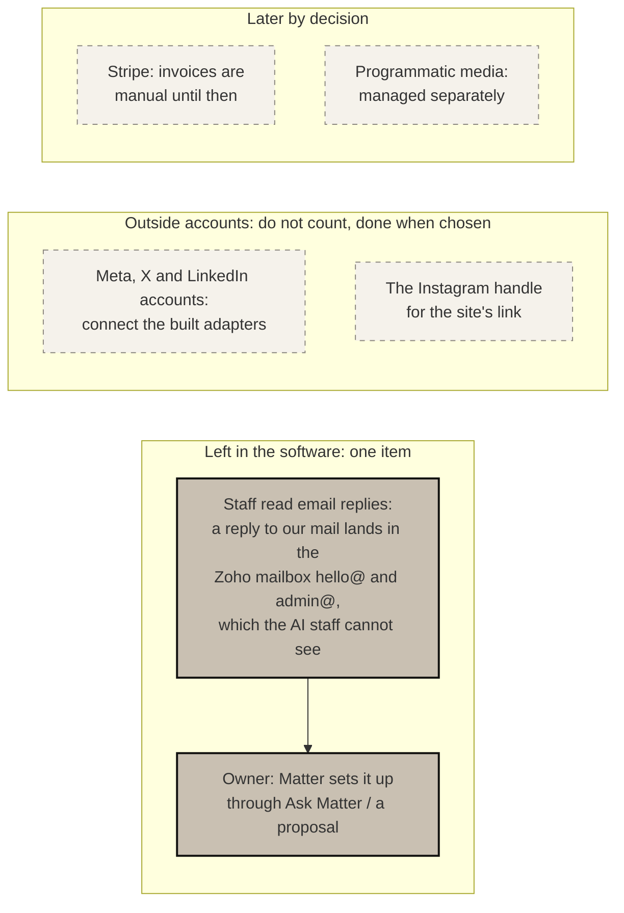

# Where Matter of Place stands, as diagrams

Pictures: [img/completion-map-1.png](img/completion-map-1.png) (the road, and where we are),
[img/completion-map-2.png](img/completion-map-2.png) (everything built), [img/completion-map-3.png](img/completion-map-3.png)
(what is left, and what does not count).

Updated 2026-10-13 by the operator's definition: completion is the setup as code and software. Accounts on outside
services (the social apps) are set up by the operator and the orchestrator whenever they choose and do not
count toward it. The build plans of 2026-10-02 (waves, slices B1b to L1) are history; their files stay in `05-plans/`.

## 1. The road, and where we are

```mermaid
flowchart LR
  S0[Shape: decisions<br/>DONE 2026-09-30] --> S1[Design direction<br/>DONE]
  S1 --> S2[System design: plans<br/>DONE]
  S2 --> S3[Build: site, admin,<br/>database, automation<br/>DONE]
  S3 --> S4[Harden: security, backups,<br/>restore drill, rollback<br/>DONE]
  S4 --> S5[Live on matterofplace.com<br/>DONE]
  S5 --> S6[AI company: Matter and<br/>the colleagues run it<br/>DONE]
  S6 --> NOW([We are here: one gap left,<br/>staff cannot read email replies])
  NOW --> LOOP[Run and improve: Saturday audit,<br/>Matter's proposals, approvals]

  classDef done fill:#EEEAE1,stroke:#575751;
  classDef here fill:#C9C0B2,stroke:#11110F,stroke-width:2px;
  class S0,S1,S2,S3,S4,S5,S6 done;
  class NOW here;
```

## 2. Everything built

## 3. What is left, and what does not count

